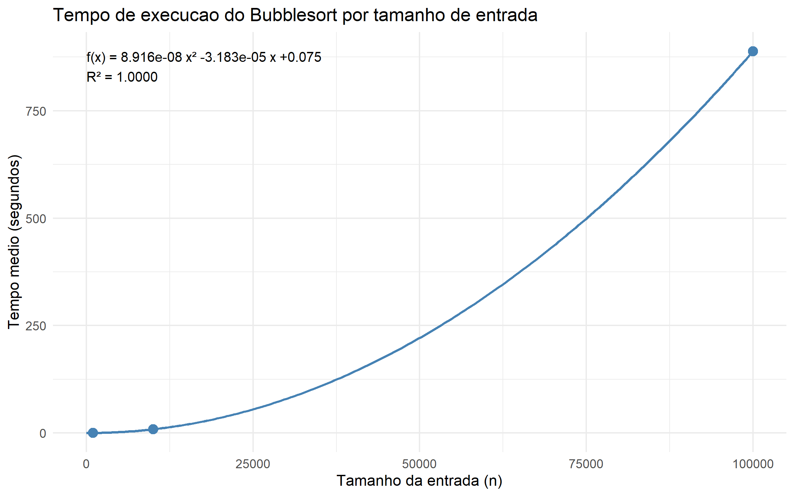

# atividade-bubble

Implementação do algoritmo Bubblesort em R, com medição do tempo de execução para entradas de 1.000, 10.000 e 100.000 elementos e estimativa para 1.000.000 de elementos. A implementação segue o pseudocódigo da página 32 do livro *Algoritmos: Teoria e Prática*, problema 2-2, Corretude do bubblesort.

## Integrantes

- Ana Carla
- Brunna Luyza

## Objetivo

Implementar o Bubblesort, coletar o tempo de execução com 10 repetições para cada conjunto de dados fornecido pelo professor e analisar como o tempo cresce conforme o tamanho da entrada aumenta, comparando o resultado com a complexidade teórica do algoritmo.

## Pseudocódigo de referência

```
BUBBLESORT(A, n)
1  for i = 1 to n - 1
2      for j = n downto i + 1
3          if A[j] < A[j - 1]
4              trocar A[j] com A[j - 1]
```

O laço interno percorre o vetor de trás para frente, e a cada rodada completa o menor elemento restante vai parar na sua posição final, à esquerda. Depois de n - 1 rodadas o vetor está em ordem crescente.

## Linguagem

R, versão 4.6.1, executado no VS Code.

## Estrutura do projeto

- `dados/`: arquivos de entrada do professor, `1000.txt`, `10000.txt`, `100000.txt` e `1000000.txt`, com um número por linha
- `ler.r`: lê um arquivo de dados e devolve um vetor numérico
- `bubblesort.r`: implementação do algoritmo, igual ao pseudocódigo do livro
- `verificar.r`: confere se o vetor ficou em ordem crescente
- `preparar.r`: devolve uma cópia do vetor original bagunçado antes de cada repetição
- `escrever.r`: grava dados em arquivo
- `simular.r`: script principal, que roda as repetições, mede o tempo, calcula a curva e gera tabelas e gráfico

## Metodologia

Para cada tamanho, o arquivo é lido uma única vez. Antes de cada repetição o vetor volta ao estado original bagunçado, porque ordenar um vetor que já está ordenado daria um tempo artificialmente baixo. O tempo de cada repetição é medido com `system.time()`, considerando apenas a chamada do `bubblesort`, e depois de cada ordenação a função `verificar` confere o resultado. Se alguma ordenação falhar, o programa para na hora.

Foram feitas 10 repetições para cada um dos tamanhos 1.000, 10.000 e 100.000. Os resultados brutos são salvos a cada repetição concluída em `resultados_bubblesort_bruto.txt`. O script completo levou cerca de 150 minutos, quase todos gastos nas repetições de 100.000.

## Resultados

Tempos em segundos, medidos em cada repetição.

| Repetição | 1.000 | 10.000 | 100.000 | 1.000.000 |
|---|---|---|---|---|
| 1 | 0,11 | 8,61 | 901,17 | |
| 2 | 0,15 | 8,61 | 915,96 | |
| 3 | 0,13 | 8,49 | 878,20 | |
| 4 | 0,11 | 9,14 | 879,98 | |
| 5 | 0,11 | 8,81 | 884,75 | |
| 6 | 0,11 | 8,58 | 907,34 | |
| 7 | 0,16 | 8,50 | 872,33 | |
| 8 | 0,17 | 8,58 | 882,31 | |
| 9 | 0,14 | 8,65 | 885,83 | |
| 10 | 0,13 | 8,75 | 876,66 | |
| Média | 0,132 | 8,672 | 888,453 | 89.124,36 estimado |
| Desvio padrão | 0,0225 | 0,1921 | 14,5654 | |

Do tamanho 1.000 para 10.000 o tempo médio cresceu cerca de 66 vezes. De 10.000 para 100.000 cresceu cerca de 102 vezes. Cada vez que a entrada fica 10 vezes maior, o tempo fica da ordem de 100 vezes maior, que é o comportamento esperado de um algoritmo quadrático.

## Gráfico



O gráfico está em escala normal e mostra os três pontos medidos com a linha de tendência polinomial de grau 2 ajustada sobre eles:

```
f(x) = 8,916e-08 x² - 3,183e-05 x + 0,075
R² = 1
```

O R² igual a 1 acontece porque há apenas três pontos medidos e a parábola tem três coeficientes, então ela passa exatamente por todos os pontos. Esse valor não prova sozinho que o algoritmo é quadrático. O que sustenta isso é o crescimento de cerca de 100 vezes no tempo a cada aumento de 10 vezes no tamanho, junto com a análise teórica.

## Estimativa para 1.000.000 de elementos

O arquivo `1000000.txt` não foi executado, porque uma única repetição levaria mais de um dia, e 10 repetições seriam inviáveis. O professor foi consultado e aceitou a estimativa nesse caso. O valor foi obtido aplicando a fórmula da curva a n = 1.000.000.

| n | Segundos | Minutos | Horas |
|---|---|---|---|
| 1.000 | 0,132 | 0,0022 | 0,00004 |
| 10.000 | 8,672 | 0,1445 | 0,0024 |
| 100.000 | 888,453 | 14,8076 | 0,2468 |
| 1.000.000 | 89.124,363 | 1.485,4061 | 24,7568 |

A estimativa depende dos três pontos medidos, então um conjunto diferente de medições, em outra máquina ou em outro momento, daria um valor um pouco diferente.

## Análise do tempo de execução

O laço interno do pseudocódigo sempre percorre todas as posições restantes, então o número de comparações é n(n - 1)/2 independentemente do conteúdo do vetor. O tempo cresce com n², ou seja, o pior caso é Θ(n²), o mesmo da ordenação por inserção, como pergunta o item d do problema 2-2. Os tempos medidos confirmam isso na prática.

Linguagens compiladas, como C++, C# e Java, tendem a executar esse mesmo algoritmo bem mais rápido que o R, que é interpretado. Por isso era esperado que a execução com 1.000.000 de elementos fosse inviável em R no prazo da atividade.

## Como executar

No terminal do VS Code, dentro da pasta do projeto:

```
R.exe --no-save
```

Depois, dentro do R:

```r
source("simular.r")
```

Arquivos gerados:

- `resultados_bubblesort_bruto.txt`: todos os tempos, repetição por repetição
- `resultados_bubblesort_resumo.txt`: média e desvio padrão por tamanho
- `tabela_final_com_estimativa.csv`: tempos em segundos, minutos e horas, com a linha do milhão estimada
- `tabela_repeticoes.csv`: quadro de repetições por tamanho
- `grafico_bubblesort.png`: gráfico com a curva polinomial